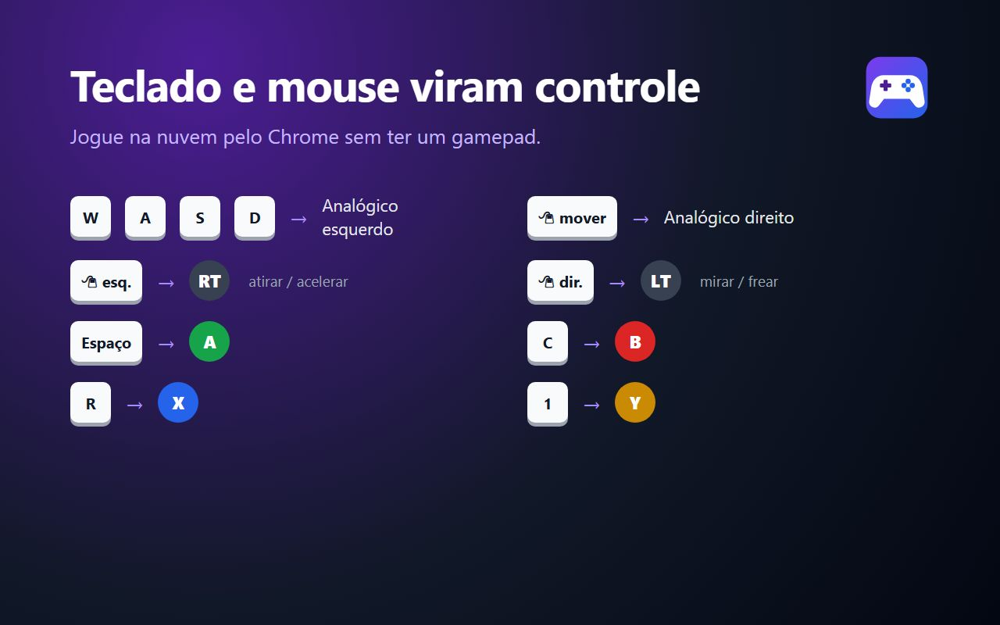

# KB Pad — teclado e mouse como controle

Extensão do Chrome que cria um controle virtual (Gamepad API, layout padrão) e mapeia teclado e mouse nele, para jogar na nuvem pelo navegador sem um controle físico.

## Instalar (modo desenvolvedor)

1. `git clone https://github.com/ailtonandrade/kbpad-extension.git`
2. Abra `chrome://extensions`, ligue o **Modo do desenvolvedor** e clique em **Carregar sem compactação**.
3. Escolha a pasta clonada.

## Usar

- **F8** liga/desliga na aba do jogo (selo **ON** no ícone). Clique na tela para capturar o mouse.
- **F9** alterna para o preset de troca rápida (ex.: a pé ↔ veículos).
- Clique no ícone da extensão para configurar presets, teclas, sensibilidade e idioma (português ou inglês).
- Depois de trocar o preset principal, recarregue (F5) a aba do jogo. A troca rápida (F9) vale na hora.

## Publicação

Materiais e textos para a Chrome Web Store em [store/STORE.md](store/STORE.md). Política de privacidade em [PRIVACY.md](PRIVACY.md).
